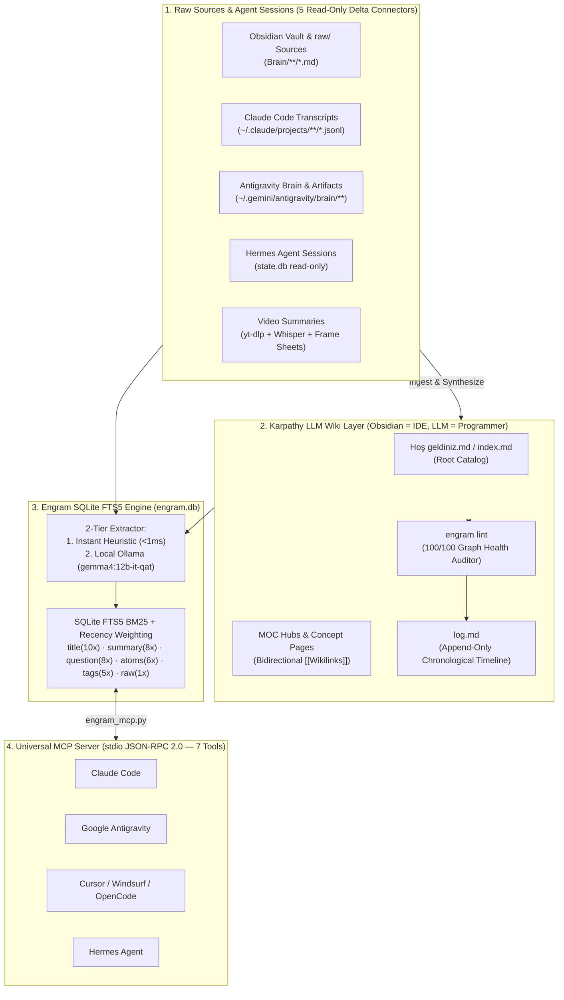

# 🧠 Engram + Karpathy LLM Wiki — Second Brain for AI Agents

> 🌐 **Language / Dil:** **English** | [🇹🇷 Türkçe Dokümantasyon (README.tr.md)](./README.tr.md)

A **zero-dependency, local-first Personal Knowledge Base (Second Brain)** that unites two complementary architectures into a single engine and **MCP Server**:

1. 📚 **[Andrej Karpathy's `LLM Wiki` Pattern](https://gist.github.com/karpathy/442a6bf555914893e9891c11519de94f):** Instead of stateless RAG that re-discovers fragments from raw files on every query, your AI agent incrementally compiles knowledge into a persistent, interlinked **Obsidian Markdown Wiki** (`raw/` immutable sources, `index.md` / `Hoş geldiniz.md` catalog, `log.md` chronological timeline, MOC hubs, and automated `engram lint` graph health checks).
2. ⚡ **Nick Saraev's Vectorless `Engram` Architecture:** A single SQLite WAL database (`engram.db`) powered by **FTS5 BM25 column-weighted search** + **logarithmic Recency Weighting** + **2-Tier Atom Extraction** (`errors`, `fixes`, `commands`, `decisions`) across 5 automatic delta connectors (**Obsidian Vault**, **Claude Code**, **Google Antigravity**, **Hermes Agent**, and **Video Summaries**).

---

## ✨ Why This Beats Traditional Vector RAG

| Feature | Traditional Vector RAG | Engram + Karpathy LLM Wiki |
|---|---|---|
| **Knowledge Accumulation** | ❌ None (re-chunks & re-retrieves from scratch on every query) | ✅ **Compounding Obsidian Wiki** (`[[Wikilinks]]`, MOCs, contradictions flagged) |
| **Search Infrastructure** | Heavy Vector DB + Embedding APIs + chunk drift | **Single SQLite file (`engram.db`)** + FTS5 BM25 + Recency Weighting (`<0.5s`) |
| **Exact Error / CLI Recall** | Cosine similarity often misses exact error codes & flags | **BM25 + Extracted Atoms** (`errors`, `fixes`, `commands`, `decisions`) |
| **Stale Info Handling** | Old chunks compete equally with new chunks | **Recency Weighting** (`1 / (1 + α · ln(1 + age_days))`) + `engram lint` |
| **Dependencies** | Docker, Chroma/Qdrant, LangChain, OpenAI Embeddings | **Zero pip dependencies** for core engine & MCP server (Python 3.10+ stdlib) |

---

## 🏗️ Architecture



---

## 🚀 Quickstart (1 Minute)

### Windows (PowerShell)
```powershell
git clone https://github.com/FatihG60/engram-llm-wiki.git
cd engram-llm-wiki
.\scripts\install.ps1
```

### macOS / Linux
```bash
git clone https://github.com/FatihG60/engram-llm-wiki.git
cd engram-llm-wiki
chmod +x scripts/install.sh
./scripts/install.sh
```

The installer:
1. Copies the clean `vault-template/` to `~/obsidian-brain/Brain` (with `raw/`, `raw/assets/`, `Hoş geldiniz.md`, `log.md`, and `.obsidian/` settings).
2. Initializes `~/obsidian-brain/engram.db` and runs the first delta sync.
3. Runs `engram lint` (`health_score: 100/100`).
4. Outputs the ready-to-paste **MCP Server JSON** for your AI agent.

---

## 🔌 MCP Server Configuration (7 Tools)

Add this block to your MCP configuration (`~/.claude.json`, Cursor MCP settings, or Antigravity `mcp_config.json`):

```json
{
  "mcpServers": {
    "engram": {
      "command": "python",
      "args": ["/absolute/path/to/engram-llm-wiki/src/engram_mcp.py"],
      "env": {
        "ENGRAM_DB_PATH": "/path/to/obsidian-brain/engram.db",
        "OBSIDIAN_VAULT_PATH": "/path/to/obsidian-brain/Brain"
      }
    }
  }
}
```

### Exposed MCP Tools
| Tool | Description |
|---|---|
| `engram_search` | Fast (`<0.5s`) SQLite FTS5 BM25 + Recency Weighted search across all 5 sources. Returns `summary`, `question`, `atoms` (`errors`, `fixes`, `commands`, `decisions`), and `pointer`. |
| `engram_get` | Fetch full `raw_text` of any record by `id` or `source_key` (with strict prompt-injection boundary). |
| `engram_remember` | Explicitly store a newly discovered root-cause, fix, CLI command, or architectural decision. |
| `engram_sync` | Run incremental delta ingestion across all 5 connectors (+ optional local Ollama enrichment). |
| `engram_stats` | Inspect database size, item counts by source, and connector health. |
| `engram_lint` | **Karpathy LLM Wiki Health Check:** Detects broken `[[Wikilinks]]`, orphan pages, dead-end pages, missing YAML frontmatter (`title`, `tags`, `aliases`, `created`), and unindexed MOC notes. |
| `engram_log` | Append a chronological entry (`## [YYYY-MM-DD] action \| Title`) to `Brain/log.md` or tail the latest entries. |

---

## 💻 CLI Reference

```bash
# 1. Sync all 5 delta connectors (instant heuristic indexing)
python src/engram.py sync

# 2. Sync + enrich top 5 items with local Ollama (gemma4:12b-it-qat)
python src/engram.py sync --enrich 5

# 3. Search with BM25 + Recency Weighting
python src/engram.py search "streaming md5 backpressure"

# 4. Run Karpathy LLM Wiki Health Check (Lint) & append result to Brain/log.md
python src/engram.py lint --log

# 5. Append or read chronological entries in Brain/log.md
python src/engram.py log ingest "Added Raft Consensus Paper" --details "Updated Distributed Systems MOC"
python src/engram.py log-tail --count 5

# 6. Show database & connector stats
python src/engram.py stats
```

---

## 📂 Repository Structure

```text
engram-llm-wiki/
├── src/
│   ├── engram.py                  # Core SQLite FTS5 BM25 + Recency + Karpathy Wiki Lint/Log engine
│   └── engram_mcp.py              # Zero-dependency JSON-RPC 2.0 stdio MCP server (7 tools)
├── vault-template/                # Ready-to-open Obsidian starter vault (100/100 lint score)
│   ├── .obsidian/                 # Preconfigured attachmentFolderPath ("raw/assets") & Graph colors
│   ├── Hoş geldiniz.md            # Root catalog (index.md)
│   ├── log.md                     # Chronological append-only log
│   ├── raw/                       # Immutable source documents (includes Karpathy's llm-wiki.md)
│   └── Architecture/              # Starter MOC & architecture synthesis notes
├── rules/
│   ├── CLAUDE.md                  # Drop-in agent schema rule for Claude Code
│   ├── AGENTS.md                  # Drop-in agent schema rule for Codex / Cursor / OpenCode
│   └── antigravity-rule.md        # Global rule for Google Antigravity
├── skills/
│   ├── engram-memory/SKILL.md     # Agent skill definition for Engram + LLM Wiki
│   └── video-summarizer/          # yt-dlp + faster-whisper + timestamped frame contact sheet pipeline
└── scripts/
    ├── install.ps1                # Windows one-command installer
    └── install.sh                 # macOS / Linux one-command installer
```

---

## 🙏 Credits & Inspiration

- **[Andrej Karpathy — `llm-wiki.md`](https://gist.github.com/karpathy/442a6bf555914893e9891c11519de94f):** For the 3-layer compiled Markdown Wiki pattern (`raw/`, `The Wiki`, `The Schema`, `index.md`, `log.md`, and `Ingest / Query / Lint` operations).
- **Nick Saraev — `Engram`:** For the vectorless SQLite FTS5 BM25 + Recency Weighting + structured Atom extraction (`errors`, `fixes`, `commands`, `decisions`) and prompt-injection isolation architecture.

## 📄 License
MIT License — see [LICENSE](./LICENSE).
