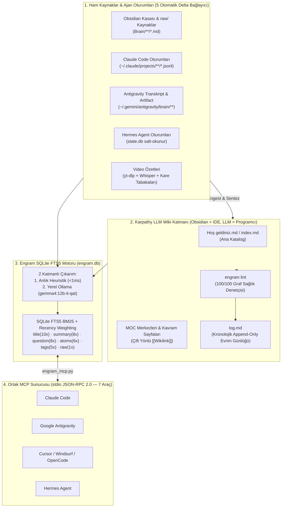

# 🧠 Engram + Karpathy LLM Wiki — Yapay Zeka Ajanları İçin İkinci Beyin (Second Brain)

> 🌐 **Dil / Language:** [🇬🇧 English Documentation (README.md)](./README.md) | **🇹🇷 Türkçe**

Sıfır harici Python bağımlılığıyla (`stdlib`) çalışan, iki güçlü bilgi mimarisini tek bir çekirdek motorda ve **MCP Sunucusunda** birleştiren yerel **İkinci Beyin (Personal Knowledge Base)** sistemi:

1. 📚 **[Andrej Karpathy'nin `LLM Wiki` Deseni](https://gist.github.com/karpathy/442a6bf555914893e9891c11519de94f):** Her soruda ham belgeleri sıfırdan tarayan ve hiçbir bilgi biriktirmeyen klasik RAG sistemleri yerine; ajanınız öğrendiği her teknik çözümü, mimariyi ve kaynağı **Obsidian Markdown Wiki**'sine (`raw/` değiştirilemez kaynaklar, `Hoş geldiniz.md` / `index.md` ana katalog, `log.md` kronolojik evrim günlüğü, MOC merkezleri ve `engram lint` sağlık denetimi) artımlı olarak derler.
2. ⚡ **Nick Saraev'in Vektörsüz `Engram` Mimarisi:** Karmaşık Vector DB veya ücretli Embedding API'leri olmadan, **tek bir SQLite WAL dosyası (`engram.db`)** üzerinde **FTS5 BM25 ağırlıklı arama** + **Logaritmik Güncellik Ağırlıklandırması (Recency Weighting)** + **Atom Çıkarımı** (`errors`, `fixes`, `commands`, `decisions`) ve 5 otomatik bağlayıcı (**Obsidian Kasası**, **Claude Code**, **Google Antigravity**, **Hermes Agent**, **Video Özetleri**) ile `<0.5 sn` içinde kurumsal hafıza araması sunar.

---

## ✨ Neden Klasik Vektör RAG Yerine Bu Mimari?

| Özellik | Klasik Vektör RAG | Engram + Karpathy LLM Wiki |
|---|---|---|
| **Bilgi Birikimi** | ❌ Yok (her soruda ham metin parçalarını sıfırdan arar) | ✅ **Bileşik Faizle Büyüyen Obsidian Wiki** (`[[Wikilink]]`, MOC, çelişki tespiti) |
| **Arama Altyapısı** | Ağır Vector DB + Embedding API + parçalanmış bağlam | **Tek SQLite dosyası (`engram.db`)** + FTS5 BM25 + Recency Weighting (`<0.5 sn`) |
| **Kesin Hata Kodu / Komut** | Kosinüs benzerliği tam hata kodlarını ve CLI bayraklarını kaçırır | **BM25 + Yapısal Atomlar** (`errors`, `fixes`, `commands`, `decisions`) |
| **Eski Bilgi Yönetimi** | 6 ay önceki hatalı not ile dünkü çözüm eşit yarışır | **Recency Weighting** (`1 / (1 + α · ln(1 + gün))`) + `engram lint` |
| **Bağımlılıklar** | Docker, Chroma/Qdrant, LangChain, OpenAI API | **Sıfır pip bağımlılığı** (Saf Python 3.10+ standart kütüphanesi) |

---

## 🏗️ Mimari Akış



---

## 🚀 Hızlı Kurulum (1 Dakika)

### Windows (PowerShell)
```powershell
git clone https://github.com/FatihG60/engram-llm-wiki.git
cd engram-llm-wiki
.\scripts\install.ps1
```

### macOS / Linux
```bash
git clone https://github.com/FatihG60/engram-llm-wiki.git
cd engram-llm-wiki
chmod +x scripts/install.sh
./scripts/install.sh
```

Kurulum betiği otomatik olarak:
1. Temiz `vault-template/` şablonunu `~/obsidian-brain/Brain` konumuna kopyalar (`raw/`, `raw/assets/`, `Hoş geldiniz.md`, `log.md` ve `.obsidian/` ayarlarıyla birlikte).
2. `~/obsidian-brain/engram.db` veritabanını oluşturup ilk senkronizasyonu yapar.
3. `engram lint` çalıştırarak kasa sağlığını doğrular (`health_score: 100/100`).
4. Ajanınıza yapıştırabileceğiniz hazır **MCP JSON** yapılandırmasını ekrana basar ve PowerShell profilinize `engram` komutunu ekler.

---

## 🔌 MCP Sunucu Yapılandırması (9 Araç — v2.0)

Ajanınızın MCP ayar dosyasına (`~/.claude.json`, Cursor MCP veya Antigravity `mcp_config.json`) şu bloğu ekleyin:

```json
{
  "mcpServers": {
    "engram": {
      "command": "python",
      "args": ["D:/Repo/engram-llm-wiki/src/engram_mcp.py"],
      "env": {
        "ENGRAM_DB_PATH": "D:/obsidian-brain/engram.db",
        "OBSIDIAN_VAULT_PATH": "D:/obsidian-brain/Brain"
      }
    }
  }
}
```

### Sunulan 9 MCP Aracı (v2.0)
| Araç | Açıklama |
|---|---|
| `engram_search` | 5 kaynak üzerinde `<0.5 sn` içinde BM25 + **Çift Dilli TR↔EN Teknik Terim Genişletme** + **Alt-Dizge (Substring) Kod Sembolü Yakalama** + Recency Weighting araması yapar. |
| `engram_get` | Eşleşen kaydın tam `raw_text` içeriğini getirir (Prompt-Injection korumalı). |
| `engram_remember` | Yeni keşfedilen bir kök nedeni, çözümü, çalışan komutu veya mimari kararı doğrudan hafızaya kaydeder. |
| `engram_sync` | 5 bağlayıcıdaki yeni/değişen dosyaları tarar (isteğe bağlı yerel Ollama `gemma4` zenginleştirmesiyle). |
| `engram_stats` | Veritabanı boyutunu, kaynak bazlı kayıt sayılarını ve bağlayıcı sağlık durumunu gösterir. |
| `engram_ingest` | **Web Clipper (`ingest`):** Herhangi bir web makalesini, GitHub Gist/README bağlantısını veya yerel dosyayı temiz Markdown'a çevirip `Brain/raw/YYYY-MM-DD_<slug>.md` olarak kaydeder, görsellerini `Brain/raw/assets/` altına indirir ve Engram'a indeksler. |
| `engram_lint` | **Karpathy LLM Wiki Sağlık Denetimi v2.0:** Kırık `[[Wikilink]]`, yetim sayfa, çıkmaz sokak, eksik YAML frontmatter ve MOC kontrolü yapar; **PageRank `top_hubs`** merkezilik skorlarını hesaplar, `unlinked_mentions` (bağlanmamış atıflar) bulup `fix_unlinked=true` ile otomatik bağlar ve `deep_lint=true` ile yerel Ollama üzerinden anlamsal çelişki taraması yapar. |
| `engram_log` | `Brain/log.md` kronolojik evrim günlüğüne `## [YYYY-MM-DD] islem \| Başlık` formatında kayıt ekler veya son N kaydı okur. |
| `engram_dashboard` | **İnteraktif HTML Gösterge Paneli:** Tek dosyalık (`dashboard.html`) etkileşimli Force-Directed Bilgi Grafı, KPI kartları, `log.md` zaman çizelgesi ve canlı Atom Gezgini üretir. |

---

## 💻 Terminal (CLI) Komutları

```powershell
# 1. Tüm 5 bağlayıcıyı senkronize et (<2 sn)
engram sync

# 2. Senkronize et + bekleyen 5 kaydı yerel Ollama (gemma4:12b-it-qat) ile zenginleştir
engram sync --enrich 5

# 3. BM25 + Çift Dilli TR<->EN Genişletme + Substring + Güncellik Ağırlıklı arama yap
engram search "önbellek geri basınç MemoryStream"

# 4. Bir web makalesini veya GitHub Gist'ini Brain/raw/ altına kırp (+ görsellerini raw/assets/ içine indir)
engram ingest "https://gist.github.com/karpathy/442a6bf555914893e9891c11519de94f"

# 5. Karpathy LLM Wiki sağlık denetimi + PageRank + Otomatik Wikilink Onarımı (--fix) + Derin Çelişki Denetimi (--deep)
engram lint --log
engram lint --fix
engram lint --deep

# 6. Tek dosyalık İnteraktif HTML Bilgi Grafı Gösterge Panelini üret ve tarayıcıda aç
engram dashboard --open

# 7. Kronolojik log.md dosyasına kayıt ekle veya son 5 işlemi gör
engram log ingest "Yeni Mimari Notu" --details "MOC ve kavram sayfaları güncellendi"
engram log-tail --count 5
```

---

## 🙏 İlham & Kaynaklar

- **[Andrej Karpathy — `llm-wiki.md`](https://gist.github.com/karpathy/442a6bf555914893e9891c11519de94f):** 3 katmanlı derlenen Markdown Wiki mimarisi (`raw/`, `The Wiki`, `The Schema`, `index.md`, `log.md` ve `Ingest / Query / Lint` operasyonları).
- **Nick Saraev — `Engram`:** Vektörsüz SQLite FTS5 BM25 + Recency Weighting + yapısal Atom çıkarımı (`errors`, `fixes`, `commands`, `decisions`) ve Prompt-Injection izolasyonu.

## 📄 Lisans
MIT Lisansı — detaylar için [LICENSE](./LICENSE) dosyasına bakın.
