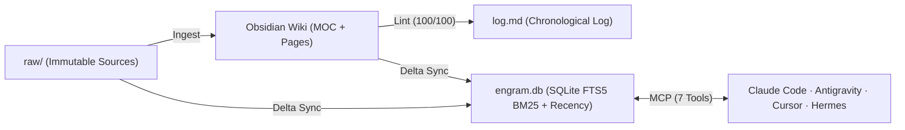

# 🏛️ Second Brain Architecture / İkinci Beyin Mimarisi (MOC)

**Root Index / Ana İndeks:** [[Hoş geldiniz]] · **Chronological Log / Günlük:** [[log]]

## Core Notes / Temel Notlar
- 📚 [[01 - Karpathy LLM Wiki and Engram Synthesis]] — Full architectural blueprint uniting Karpathy's 3-layer compiled Markdown Wiki with Engram's vectorless SQLite FTS5 BM25 + Recency Weighting engine.

Back / Geri: [[Hoş geldiniz]]
