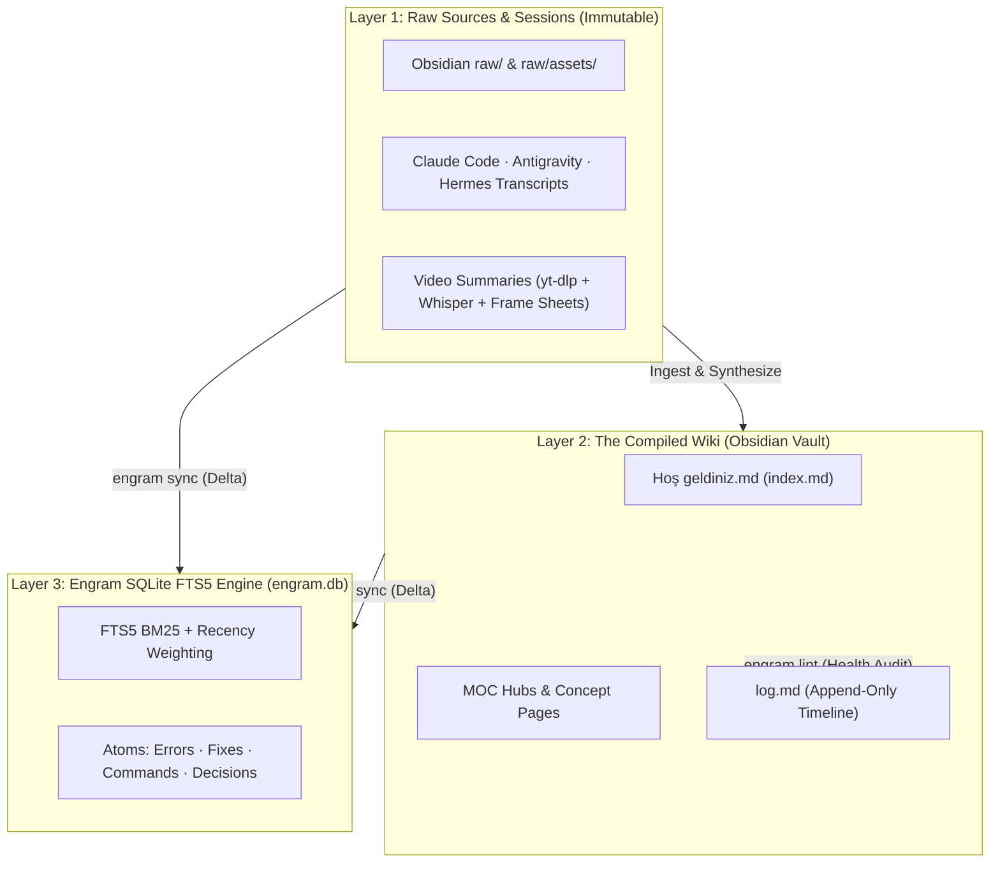

# 📚 Karpathy LLM Wiki & Engram Synthesis / İkinci Beyin Sentezi

**MOC:** [[00 - Second Brain Architecture (MOC)]] · **Root Index:** [[Hoş geldiniz]] · **Chronological Log:** [[log]]

> **Raw Source:** `raw/2026-10-24_karpathy-llm-wiki.md` ([Andrej Karpathy's `llm-wiki.md` Gist](https://gist.github.com/karpathy/442a6bf555914893e9891c11519de94f))

---

## 1. Why Compiled Knowledge Beats Standard RAG / Neden Klasik RAG Yerine Derlenen Wiki?

Traditional RAG systems retrieve fragmented chunks from raw files on every query with **zero knowledge accumulation**.
Klasik RAG sistemleri her soruda ham belgeleri sıfırdan tarar; **bilgi birikimi yoktur**.

By combining **Andrej Karpathy's `LLM Wiki`** with **Nick Saraev's `Engram`**, this architecture gives your AI agents both:
1. **A Persistent, Incrementally Compiled Markdown Wiki (`Obsidian`):** Cross-referenced `[[Wikilinks]]`, MOCs, `raw/` immutable sources, `log.md` chronological timeline, and automated `engram lint` health checks.
2. **A Sub-Millisecond Institutional Memory Engine (`engram.db`):** Single-file SQLite WAL database with FTS5 BM25 column weighting (`title 10x`, `summary 8x`, `question 8x`, `atoms 6x`, `tags 5x`, `raw 1x`), logarithmic Recency Weighting, and 5 automatic delta connectors (`obsidian`, `claude`, `antigravity`, `hermes`, `video`).

---

## 2. Three Core Operations (`Ingest`, `Query`, `Lint`)

| Operation | Description (EN) | Açıklama (TR) |
|---|---|---|
| **1. Ingest** | Drop a source into `raw/` or solve a complex engineering problem; the agent updates MOCs, creates interlinked notes, and appends to [[log]]. | Yeni bir kaynak veya teknik çözüm geldiğinde ajan MOC ve kavram sayfalarını günceller, [[log]] dosyasına işler. |
| **2. Query** | Search across all 5 sources via `engram_search` (`<0.5s`) and file valuable syntheses back into the Wiki as permanent notes. | `engram_search` ile tüm hafızada `<0.5 sn` içinde arama yapılır; değerli analizler Wiki'ye yeni sayfa olarak kaydedilir. |
| **3. Lint** | Run `engram lint --log` (or MCP `engram_lint`) to check broken `[[Wikilinks]]`, orphan pages, dead-end pages, YAML frontmatter, and MOC coverage. | `engram lint --log` ile kırık bağlantılar, yetim notlar, YAML frontmatter ve MOC bütünlüğü denetlenir. |

---

Back / Geri: [[00 - Second Brain Architecture (MOC)]] · [[Hoş geldiniz]]
